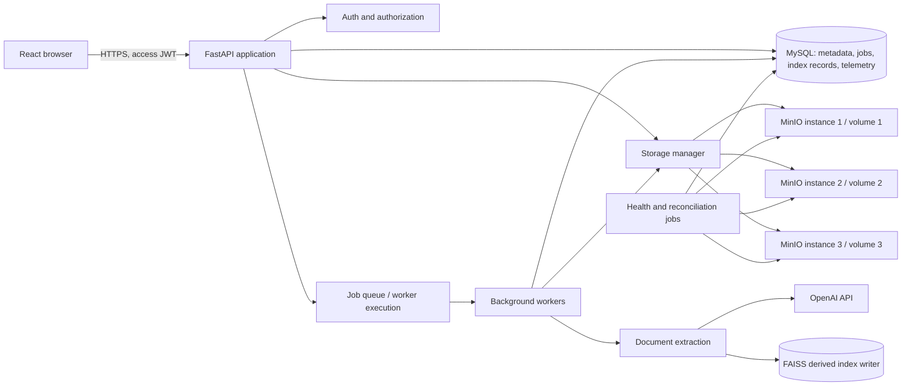

# IFSS System Architecture

**Status:** Proposed, for review
**Scope:** Architecture and planning only; no application code or dependencies are introduced in this phase.

## 1. Goals and assumptions

IFSS provides users with secure file lifecycle management over a distributed object-storage deployment, with fault-aware replication and AI-assisted discovery. The initial product should be operable as a modular system without prematurely splitting into microservices.

Assumptions to validate before implementation:

1. Users access files through the IFSS API; MinIO credentials and internal endpoints are never sent to the browser.
2. The initial development environment has three separate MinIO instances with separate persistent volumes. They are independent application targets but do not provide host-level fault independence when colocated on one host.
3. IFSS application-managed replication starts at three copies; uploads require two verified copies before the database commit point. Production placement, hardware failure domains, regions, capacity, and service-level objectives still require approval.
4. The first release is a single logical tenant/user space model. Tenant isolation can be added as an explicit authorization dimension if required.
5. OpenAI processing is policy-gated. Users must be informed that selected document text may be sent to an external model provider.
6. FAISS is a derived index, not durable canonical data. Chunk text and embedding vectors are retained in MySQL so an index can be reconstructed.

## 2. High-level architecture



The browser calls only the API. The API is the control plane: it authenticates users, checks ownership, records metadata, and coordinates object placement. Background workers perform slow or retryable work such as replication, integrity checks, extraction, embeddings, summaries, and deletion cleanup. A version is committed after two verified copies; the third is repaired asynchronously. See [storage architecture](storage-architecture.md), [fault-tolerance design](fault-tolerance-design.md), [security design](security-design.md), [AI/RAG architecture](ai-rag-architecture.md), and [recovery and backup](recovery-and-backup.md) for operational detail.

### Logical modules

- **API layer:** request validation, response shaping, versioned routes, OpenAPI.
- **Identity and access:** password verification, JWT issuance/validation, refresh/revocation policy, ownership checks.
- **File catalog:** metadata, lifecycle states, version and deletion records.
- **Storage control plane:** node registry, placement, replication, object verification, health state, repair operations.
- **Ingestion pipeline:** safe type detection, extraction, chunking, summary generation, embedding generation.
- **Search and chat:** retrieval, authorization filtering, answer generation with source references.
- **Worker runtime:** durable job processing, retries, idempotency, dead-letter visibility.
- **Observability:** structured logs, metrics, traces, audit events, readiness/liveness. Initial storage dashboard time series are sampled into MySQL and retained for 30 days; alert routing and on-call ownership are operational decisions.

These are package boundaries in one deployable backend initially. Worker processes may use the same application package and configuration, but run independently from HTTP processes.

## 3. Proposed repository structure

```text
ifss/
├── README.md
├── docs/
│   ├── architecture.md
│   ├── database-design.md
│   ├── api-roadmap.md
│   ├── development-roadmap.md
│   ├── storage-architecture.md
│   ├── fault-tolerance-design.md
│   ├── security-design.md
│   ├── ai-rag-architecture.md
│   ├── recovery-and-backup.md
│   ├── ui-ux-design.md
│   └── architecture-review-summary.md
├── backend/                         # FastAPI application (later phase)
│   ├── app/
│   │   ├── api/v1/                  # Route composition and schemas
│   │   ├── core/                    # Settings, security, errors, logging
│   │   ├── db/                      # MySQL session and migrations
│   │   ├── modules/
│   │   │   ├── auth/
│   │   │   ├── files/
│   │   │   ├── storage/
│   │   │   ├── search/
│   │   │   ├── chat/
│   │   │   └── health/
│   │   ├── workers/                 # Async jobs and scheduled tasks
│   │   └── main.py
│   ├── migrations/
│   └── tests/
├── frontend/                        # React application (later phase)
│   ├── src/
│   │   ├── app/                     # Routing and app composition
│   │   ├── features/                # auth, files, search, chat, dashboard
│   │   ├── components/              # Shared UI
│   │   ├── services/                # Typed API client
│   │   └── styles/
│   └── tests/
├── deploy/                          # Later: compose, proxy, deployment config
├── scripts/                         # Later: operational and development scripts
└── .env.example                     # Names and safe placeholders only
```

Dependencies should be selected only when their corresponding milestone begins. The queue implementation, ORM/migration tooling, document parsers, and frontend build/test tooling remain open choices until requirements and operational constraints are confirmed.

## 4. Component responsibilities and boundaries

### React frontend

Responsive dashboard for authentication, file browsing, upload progress, file details, replication/health visibility, semantic search, summaries, and document chat. It handles presentation and client-side validation only. It must not hold MinIO credentials or OpenAI keys. JWT storage and refresh behavior require a deliberate XSS/CSRF threat review before implementation; prefer secure, HTTP-only cookie-based refresh where deployment topology allows it.

### FastAPI API

Stateless request handling and authorization. It issues short-lived access JWTs and uses server-side policy for user ownership. Upload/download should use streaming endpoints initially or narrowly scoped, short-lived presigned URLs after authorization. A presigned URL must refer to a specific object/version and expire quickly. File metadata is not considered proof that an object exists.

### MySQL

Canonical transactional records: users, file records, object replicas, storage nodes, processing jobs, summaries, comparison results, extracted document/chunk metadata, and audit events. One-minute storage-dashboard samples are retained for 30 days in dedicated MySQL telemetry tables. Use migrations, foreign keys, uniqueness constraints, and indexes. Avoid storing large file payloads or FAISS binary blobs in relational rows.

### MinIO

Stores object bytes. The initial development setup runs three separate instances with independent volumes; IFSS writes whole-object replicas across them. Use private buckets, TLS, least-privilege service credentials, and immutable version-specific keys. A single-host development setup is not physically fault tolerant. IFSS application copies and MinIO's internal erasure coding are different protection layers ([MinIO erasure coding documentation](https://docs.min.io/aistor/operations/core-concepts/erasure-coding/)).

### Workers and queue

Workers handle asynchronous and retryable work. A durable queue is recommended before production; implementation choice is pending. A MySQL-backed outbox/job table can provide a simple first step if throughput is modest, with a broker introduced when operational need justifies it. Each job has an idempotency key, attempt count, lease/visibility timeout, and terminal failure state.

## 5. Security and data protection

- Hash passwords using a modern adaptive password hashing scheme; never store or log plaintext passwords.
- Sign JWTs with a configured secret/private key outside source control. Validate issuer, audience, expiry, algorithm, and token purpose. Support revocation/refresh rotation as designed.
- Enforce authorization on every file, search result, chat context, and download request. Filter retrieval by user/tenant before prompt assembly.
- Generate opaque object keys; do not use user filenames as storage paths. Store original names as display metadata and sanitize them on output.
- Validate size, extension and detected content type; treat files as untrusted. Apply parser timeouts/resource limits and malware-scanning policy where required.
- Encrypt transport with TLS. Enable encryption at rest for database disks, MinIO volumes, backups, and secrets according to deployment environment.
- Never expose credentials in API responses, frontend bundles, logs, or committed configuration. Commit only `.env.example` with fake placeholders.
- Audit authentication events, file lifecycle changes, node changes, and administrative actions without logging document contents or bearer tokens.
- Define deletion semantics: mark deletion requested, prevent new access, remove all replicas and derived content, then retain only minimal audit/tombstone data per retention policy.

## 6. Reliability and operations

- Health checks distinguish process liveness from readiness (database and required dependencies reachable).
- Node health is based on heartbeat/probe results and recent error/latency signals, not a single failed request. Use healthy, degraded, unavailable, and draining states.
- Reconciliation compares catalog intent with actual object presence and replica counts. Repair is queued, rate-limited, and observable.
- Backups cover MySQL, object data, and configuration/secrets recovery procedures. FAISS can be rebuilt from durable embedding records.
- API and worker operations should expose job status, retry counts, storage capacity, replica health, indexing lag, and provider errors as metrics.
- Define recovery objectives and test restoration before calling the system fault tolerant.

## 7. Key trade-offs and open decisions

| Decision | Proposed starting point | Revisit when |
|---|---|---|
| Deployment shape | Modular monolith plus separate worker process | Teams or scaling profiles require independent services |
| Upload path | API streaming for initial secure path; benchmark before large-file rollout | Large files/throughput make short-lived presigned multipart uploads preferable |
| Replication | RF=3 across three distinct targets; commit after 2 verified copies | Production failure domains, geography, cost, and RPO are approved |
| Queue | Durable job abstraction; simple DB outbox can start | Job volume or latency demands a broker |
| Vector persistence | Persist vectors/chunk refs durably; rebuild FAISS index | Corpus size and multi-process deployment require another vector service |
| AI calls | Worker-side, bounded, retryable, user-visible processing state | Privacy, residency, cost, or provider requirements change |

Before production implementation, confirm target deployment/failure domains, expected file sizes/volume, tenant model, privacy/retention requirements, quotas, backup target and owner, RPO/RTO, and OpenAI data policy. These remain explicit production gates in [recovery and backup](recovery-and-backup.md) and [development roadmap](development-roadmap.md); proposed values are not service promises.
