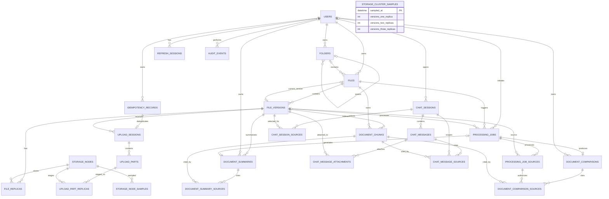

# IFSS Database Design

**Status:** Logical schema proposal. Physical DDL and migrations belong to the database implementation milestone.

MySQL is the source of truth for identities, file metadata, object placement, processing state, and authorization. Object bytes live in MinIO. FAISS is rebuildable and is not the authority for ownership or file existence.

## Entity relationships

## Tables

### `users`

| Column | Type (logical) | Notes |
|---|---|---|
| `id` | UUID / binary UUID | Primary key |
| `email` | varchar | Unique, normalized lowercase |
| `password_hash` | varchar | Adaptive hash only |
| `display_name` | varchar nullable | User-facing name |
| `role` | enum/string | Start with `user`, reserve administrative role |
| `status` | enum/string | `active`, `disabled`, `pending` |
| `created_at`, `updated_at` | UTC datetime | Audit timestamps |
| `last_login_at` | UTC datetime nullable | Optional operational field |

Indexes: unique normalized email; status. No credential or token columns unless a defined refresh-token design requires hashed token identifiers.

### `folders`

User-owned folder hierarchy. Root folders have `parent_id = NULL`; folder names are normalized for duplicate checks within the same parent. Columns: UUID `id` (PK); UUID `owner_id` (FK to users); nullable UUID `parent_id`; `name`; `state` (`active`, `deleting`, `deleted`); timestamps. Unique `(owner_id, id)` for ownership FKs; composite FK `(owner_id, parent_id)` references `folders(owner_id, id)` to prevent cross-owner parenting. Index `(owner_id, parent_id, name)` and `(owner_id, state)`. Root-level uniqueness with nullable parents must be enforced consistently because MySQL unique indexes permit multiple NULL values.

### `files`

| Column | Type (logical) | Notes |
|---|---|---|
| `id` | UUID | Public opaque ID / primary key |
| `owner_id` | UUID | FK to users; indexed |
| `folder_id` | UUID nullable | Optional folder; FK scoped to same owner |
| `original_name` | varchar | Display name, never used as object key |
| `media_type` | varchar nullable | Detected type preferred over client declaration |
| `current_version_id` | UUID nullable | Points to last successfully committed version |
| `state` | enum/string | `active`, `deleting`, `deleted`, `lost` |
| `created_at`, `updated_at`, `deleted_at` | UTC datetime | Lifecycle timestamps |
| `metadata_json` | JSON nullable | Allowlisted optional metadata only |

Indexes: `(owner_id, created_at)`, `(owner_id, folder_id, created_at)`, `(owner_id, original_name)`, `state`; unique `(owner_id, id)` to support owner-scoped composite foreign keys; `(id, current_version_id)` for the composite current-version foreign key. Composite FK `(owner_id, folder_id)` references `folders(owner_id, id)`. Avoid full text indexing document bodies in MySQL.

### `file_versions`

Immutable content identity within a file. Each replacement creates a new row; it never overwrites the current version's bytes.

Columns: UUID `id` (PK); UUID `file_id` (FK to `files.id`); nullable UUID `base_current_version_id` (the current pointer observed when this new version was initiated); unsigned `version_number`; `size_bytes`; detected `media_type`; verified `checksum_sha256`; `state` (upload lifecycle: `initiated`, `receiving`, `staged`, `verifying`, `committed`, `deleting`, `deleted`, `failed`); `replication_state` (`pending`, `degraded`, `healthy`, `lost`); `replication_target`; `commit_min_replicas`; `created_at`; `committed_at`; `deleted_at`. Unique `(file_id, version_number)` and unique `(file_id, id)` (candidate key for composite version FKs). Composite FK `(file_id, base_current_version_id)` references `file_versions(file_id, id)`; it is null for a file's first version. A version is downloadable only if committed and at least one replica is healthy. Under initial policy, commit requires two verified replicas.

`files.current_version_id` must identify a version belonging to that same file. Enforce this with a composite foreign key: `files(id, current_version_id)` references `file_versions(file_id, id)`. Keep `current_version_id` nullable until the first version commits. Because this creates a table-order dependency, create both tables and add the composite constraint in the same migration after both exist. Do not use only a foreign key from `current_version_id` to `file_versions.id`, since that would allow a file to point to another file's version.

### `storage_nodes`

Represents a registered MinIO endpoint, pool, or independently managed failure domain. Keep endpoint secrets in a secret manager, not this table.

| Column | Type (logical) | Notes |
|---|---|---|
| `id` | UUID | Primary key |
| `name` | varchar | Unique operator-assigned name |
| `endpoint_ref` | varchar | Non-secret config/secret-manager reference |
| `region` / `failure_domain` | varchar | Placement attributes |
| `state` | enum/string | `healthy`, `degraded`, `unavailable`, `draining`, `disabled` |
| `capacity_bytes`, `used_bytes` | unsigned bigint nullable | From trusted telemetry |
| `last_heartbeat_at` | datetime nullable | Probe time |
| `last_error_code` | varchar nullable | Sanitized category, no secret material |
| `created_at`, `updated_at` | UTC datetime | |

### `storage_node_samples`

Time-series source for node history and storage dashboards. The monitoring worker probes nodes every 30 seconds and writes one sample per node per minute. Columns: UUID `storage_node_id` (FK to `storage_nodes.id`); UTC `sampled_at`; observed node `state`; nullable `capacity_bytes`, `used_bytes`, `latency_ms`; `probe_success`; nullable sanitized `safe_error_code`. Primary key `(storage_node_id, sampled_at)`; index `(sampled_at, state)`. Keep raw samples for 30 days, then purge them; current state remains in `storage_nodes`. Historical data is operational telemetry, not a source of file or replica truth.

### `storage_cluster_samples`

One MySQL snapshot per minute, written by the monitoring worker from committed version/replica records and interval job counters. Columns: UTC `sampled_at` (PK); counts of committed versions with one, two, or three verified replicas; `upload_bytes_delta`; `repairs_completed_delta`; `coverage_state` (`complete`, `partial`). Keep for 30 days and purge on the same schedule as node samples. This table is the source for historical cluster replica distribution and aggregate storage analytics; current file replication truth remains in `file_versions` and `file_replicas`.

### `file_replicas`

One row per physical logical copy, with an object key unique within its storage target.

| Column | Type (logical) | Notes |
|---|---|---|
| `id` | UUID | Primary key |
| `file_version_id` | UUID | FK to immutable file_versions |
| `storage_node_id` | UUID | FK to storage_nodes |
| `bucket` | varchar | Private bucket |
| `object_key` | varchar | Opaque and unique per node/bucket |
| `object_version` | varchar nullable | MinIO version ID where enabled |
| `state` | enum/string | `planned`, `writing`, `verifying`, `healthy`, `retry_wait`, `missing`, `corrupt`, `unavailable`, `deleting`, `deleted` |
| `checksum_sha256` | binary/char | Verified copy checksum |
| `verified_at` | datetime nullable | Last successful verification |
| `created_at`, `updated_at` | UTC datetime | |

Constraints: unique `(file_version_id, storage_node_id)` so one service cannot count as multiple replicas; unique `(storage_node_id, bucket, object_key)`; index `(file_version_id, state)` and `(storage_node_id, state)`. A replacement copy on the same node reuses the logical row only after the previous object operation is reconciled; placement never counts two objects on one node as two replicas.

### `upload_sessions`

Durable resumable upload intent. Columns: UUID `id` (PK); UUID `owner_id`; UUID `file_id`; UUID `file_version_id`; nullable UUID `idempotency_record_id`; `state` (`initiated`, `receiving`, `paused`, `completing`, `committed`, `aborting`, `retry_wait`, `failed`, `aborted`, `expired`); `expected_size_bytes`; optional `expected_sha256`; configured `part_size_bytes`; `expires_at`; timestamps. FKs `(owner_id, file_id)` → `files(owner_id, id)`, `(file_id, file_version_id)` → `file_versions(file_id, id)`, and `(idempotency_record_id, owner_id)` → `idempotency_records(id, owner_id)`. The composite idempotency FK uses the same UUID types/order as its referenced unique key and must not use `ON DELETE SET NULL`, which would also null the non-null owner. Before purging an expired idempotency record, clear the upload's nullable `idempotency_record_id` in a transaction after the upload is terminal and cleanup is complete; otherwise the FK restricts deletion. The service also verifies that the linked idempotency operation is the upload-creation operation. Indexes `(owner_id, state, updated_at)` and `(file_version_id, state)`. The version row stores the captured optimistic concurrency precondition, including for version-restore jobs. `aborting` is persisted while staged data cleanup is queued/running; the upload becomes `aborted` only after cleanup completes or reconciles as already absent.

### `upload_parts`

One accepted client part per upload session. Columns: UUID `upload_session_id`; unsigned `part_number`; `size_bytes`; `checksum_sha256`; `state` (`receiving`, `verified`, `failed`); `created_at`; `verified_at`. Primary key `(upload_session_id, part_number)`; FK to `upload_sessions`; index `(upload_session_id, state)`.

### `upload_part_replicas`

Server-side staged copy of a part on an independent MinIO service. Columns: UUID `upload_session_id`; unsigned `part_number`; UUID `storage_node_id`; `staging_object_key`; `state` (`writing`, `verified`, `failed`, `deleting`); `checksum_sha256`; timestamps. Primary key `(upload_session_id, part_number, storage_node_id)`; FK `(upload_session_id, part_number)` → `upload_parts`; FK `storage_node_id` → `storage_nodes`; unique `(storage_node_id, staging_object_key)`. This table contains internal references only, never credentials.

### `processing_jobs`

Durable work ledger for upload finalization, replication, extraction, embedding, summarization, deletion, and repair.

Columns: UUID `id` (PK); nullable UUID `owner_id` (FK to users for user-initiated jobs); nullable UUID `file_id`; nullable UUID `file_version_id`; `kind`; `state` (`queued`, `running`, `retry_wait`, `succeeded`, `failed`, `cancelled`); `idempotency_key` unique; `attempts`; `available_at`; `lease_until`; `lease_owner`; `last_error_code`; timestamps. A file-scoped job requires a non-null owner; `file_version_id` may be non-null only when `file_id` is non-null. Enforce these rules with MySQL `CHECK` constraints (`file_id IS NULL OR owner_id IS NOT NULL`; `file_version_id IS NULL OR file_id IS NOT NULL`). Add FKs `(owner_id, file_id)` → `files(owner_id, id)` and `(file_id, file_version_id)` → `file_versions(file_id, id)`. The second composite FK ensures a referenced version belongs to the same file; nullable `file_version_id` permits file-wide jobs. System-wide jobs may leave all three scope columns null. Keep the UUID column types identical to the referenced columns. Unique `(id, owner_id)` supports owner-scoped source links; also declare unique `(id, owner_id, file_id, file_version_id)` as the candidate key for summary-job references. Payloads contain validated references/parameters, not secrets or document text. Index `(state, available_at)`, `(owner_id, state, available_at)`, and `(file_version_id, kind)`. Apply and verify `CHECK` constraints on a MySQL version that enforces them.

The job row also serves as the transactional outbox for the initial implementation: domain state and queued work are committed in the same MySQL transaction. Claiming must use an atomic conditional update/locking strategy supported by the selected MySQL version.

### `idempotency_records`

Durable deduplication records for authenticated API mutations. Columns: UUID `id` (PK); UUID `owner_id` (FK to users); `operation` (stable route/action identifier); `idempotency_key`; `request_hash` (SHA-256 of the canonical validated request); `state` (`in_progress`, `completed`, `failed`); nullable HTTP `response_status`; nullable safe `response_json` or resource type/ID for replay; `created_at`; `updated_at`; nullable `expires_at` (unset while in progress, assigned at terminal state). Unique `(owner_id, operation, idempotency_key)` and unique `(id, owner_id)`; indexes `(state, expires_at)` and `(owner_id, expires_at)`. The second unique key is a candidate key for upload-session composite ownership enforcement; both columns use the same UUID representation as the referencing table. Do not store credentials, access/refresh tokens, file bytes, or document text in replay data. Authentication routes that issue credentials use their own semantics and must not persist/replay token responses here.

On first use, insert the record before external side effects; concurrent duplicates wait for or return the same operation result. Same key with a different request hash returns conflict. Keep in-progress records until terminal completion or upload-session expiry. Proposed retention is 24 hours after terminal completion, with upload-operation records retained through the upload-session expiry plus 24 hours; expired records may be purged and the key reused. Retention/TTL values are configurable and must be confirmed before production. Internal worker deduplication keys on `processing_jobs` remain distinct from client request idempotency.

### `document_summaries`

Durable, version-specific PDF/document summary record. Columns: UUID `id` (PK); UUID `owner_id`; UUID `file_id`; UUID `file_version_id`; nullable UUID `processing_job_id`; `state` (`queued`, `running`, `retry_wait`, `succeeded`, `failed`, `cancelled`, `deleted`); nullable `summary_text`; `provider_id`; `model_id`; `prompt_version`; nullable `safe_error_code`; `created_at`; nullable `started_at`, `completed_at`, `deleted_at`; `updated_at`. Composite FKs `(owner_id, file_id)` → `files(owner_id, id)`, `(file_id, file_version_id)` → `file_versions(file_id, id)`, and `(processing_job_id, owner_id, file_id, file_version_id)` → `processing_jobs(id, owner_id, file_id, file_version_id)`; unique nullable `processing_job_id` and unique `(id, owner_id, file_version_id)` for citation FKs. The job FK ensures that a linked job has the same owner, file, and version; null `processing_job_id` is allowed for inline summaries. Index `(owner_id, created_at)` and `(file_version_id, state)`. Processing states mirror the linked job; `deleted` is the summary record's deletion lifecycle state. Only `succeeded` rows contain summary text; never store credentials or hidden prompts. Deletion and retention follow the source version's deletion policy.

### `document_summary_sources`

Normalized citation references for a summary. Columns: UUID `summary_id`; UUID `owner_id`; UUID `file_version_id`; UUID `document_chunk_id`; unsigned `source_order`; source-locator snapshot. Primary key `(summary_id, document_chunk_id)`; unique `(summary_id, source_order)`. Composite FKs `(summary_id, owner_id, file_version_id)` → `document_summaries(id, owner_id, file_version_id)` and `(owner_id, file_version_id, document_chunk_id)` → `document_chunks(owner_id, file_version_id, id)`. Citation rows therefore cannot point to a different owner or version.

### `document_comparisons`

Durable completed result for a multi-document comparison job. Columns: UUID `id` (PK); UUID `processing_job_id`; UUID `owner_id`; `result_json` (comparison text/sections; citations are normalized separately); `provider_id`; `model_id`; `created_at`; `completed_at`. Unique `processing_job_id`; unique `(id, processing_job_id, owner_id)`; composite FK `(processing_job_id, owner_id)` → `processing_jobs(id, owner_id)`. The job's `processing_job_sources` rows are the canonical source-version list. Before returning a result, recheck file/version access. When a source version is deleted, hide the result immediately and purge it through the source-deletion policy.

### `document_comparison_sources`

Normalized citations for comparison results. Columns: UUID `comparison_id`; UUID `processing_job_id`; UUID `owner_id`; UUID `file_version_id`; UUID `document_chunk_id`; unsigned `source_order`; source-locator snapshot. Primary key `(comparison_id, document_chunk_id)`; unique `(comparison_id, source_order)`. Composite FKs `(comparison_id, processing_job_id, owner_id)` → `document_comparisons(id, processing_job_id, owner_id)`, `(processing_job_id, owner_id, file_version_id)` → `processing_job_sources(job_id, owner_id, file_version_id)`, and `(owner_id, file_version_id, document_chunk_id)` → `document_chunks(owner_id, file_version_id, id)`. Citations can only reference a chunk from a version authorized as a job source.

### `processing_job_sources`

For multi-source asynchronous jobs, associate each job with its authorized input versions and source order. Columns: UUID `job_id`; UUID `owner_id`; UUID `file_id`; UUID `file_version_id`; unsigned `source_order`. Primary key `(job_id, file_version_id)`; unique `(job_id, owner_id, file_version_id)` for result-citation FKs; unique `(job_id, source_order)`. Composite FKs `(job_id, owner_id)` → `processing_jobs(id, owner_id)`, `(owner_id, file_id)` → `files(owner_id, id)`, and `(file_id, file_version_id)` → `file_versions(file_id, id)`. Index `(job_id, source_order)` and `(owner_id, file_version_id)`. This allows job-status reads to remain owner-scoped for comparisons involving multiple files.

### `refresh_sessions`

Columns: UUID `id`; UUID `user_id`; `token_hash`; `family_id`; `issued_at`; `expires_at`; `rotated_at`; `revoked_at`; optional safe device/session metadata. Store no raw refresh token. Index active sessions by `(user_id, revoked_at, expires_at)` and unique token hash. Reuse of a rotated token revokes the family.

### `document_chunks`

Durable retrieval metadata; can be replaced by normalized tables if scale requires.

Columns: UUID `id`; UUID `file_id`; UUID `file_version_id`; UUID `owner_id`; `chunk_index`; `source_locator` (page/section/offset); `chunk_text` or a durable private object reference; `content_hash`; `embedding_model`; `embedding_dimensions`; `embedding_bytes` (canonical float32 representation); `chunking_version`; `index_state`; `created_at`. Unique `(file_version_id, chunk_index, embedding_model, chunking_version)` and unique `(owner_id, file_version_id, id)` for owner/version-scoped citation FKs. Composite FKs `(owner_id, file_id)` → `files(owner_id, id)` and `(file_id, file_version_id)` → `file_versions(file_id, id)`. Ensure deletion workflows remove text/vectors and index entries. Initial proposal stores canonical vector bytes and text in MySQL for recoverability; reassess storage sizing before production scale.

### `chat_sessions`

One conversation owned by one user. `mode` distinguishes general LLM conversation from document-grounded conversation. A session may select multiple immutable file versions through `chat_session_sources`; sharing is not included in the initial model.

Columns: UUID `id` (PK); UUID `user_id` (FK to `users.id`); `mode` (`general`, `documents`); `title`; `state` (`active`, `archived`, `deleted`); optional non-secret `preferred_provider_id` and `preferred_model_id`; `created_at`; `updated_at`; `deleted_at`. Unique `(id, user_id)` supports owner-enforcing composite FKs. Index `(user_id, updated_at)` and `(user_id, state, updated_at)`.

### `chat_messages`

Ordered user/assistant messages belonging to a session. Do not persist hidden system prompts or provider secrets.

Columns: UUID `id` (PK); UUID `session_id` (FK to `chat_sessions.id`); unsigned `sequence_number`; `role` (`user`, `assistant`); `content`; `state` (`pending`, `streaming`, `complete`, `interrupted`, `failed`, `cancelled`, `deleted`); nullable `cancel_requested_at`; nullable `client_request_id` (idempotency key); nullable `provider_id`, `model_id`, safe `error_code`, unsigned `input_tokens`, `output_tokens`; `created_at`; nullable `completed_at`. Unique `(session_id, sequence_number)`, `(session_id, client_request_id)`, and `(id, session_id)`; index `(session_id, created_at)`. A cancellation request is recorded by setting `cancel_requested_at` while the persisted message remains `streaming`; the worker later stores `cancelled` if cancellation wins the race, or `complete` if generation already finished. Persist partial output only with an explicit `interrupted` or `cancelled` state; do not store credentials or hidden prompts.

Message ownership is inherited through `chat_messages.session_id` → `chat_sessions.user_id` → `users.id`; do not duplicate `user_id` on each message, which could drift from the session owner.

### `chat_session_sources`

The immutable file versions selected as persistent context for a document conversation. A selected source does not itself authorize retrieval; the API checks session ownership and current file/version state on every request.

Columns: UUID `session_id`; UUID `user_id`; UUID `file_id`; UUID `file_version_id`; `added_at`. Primary key `(session_id, file_version_id)`. FKs `(session_id, user_id)` → `chat_sessions(id, user_id)`, `(user_id, file_id)` → `files(owner_id, id)`, and `(file_id, file_version_id)` → `file_versions(file_id, id)`. Index `(user_id, file_version_id)`.

### `chat_message_attachments`

The immutable file versions explicitly attached to a single user message. This is separate from assistant citations, which identify retrieved evidence.

Columns: UUID `chat_message_id`; UUID `session_id`; UUID `user_id`; UUID `file_id`; UUID `file_version_id`; unsigned `source_order`; `attached_at`. Primary key `(chat_message_id, file_version_id)`; unique `(chat_message_id, source_order)`. FKs `(chat_message_id, session_id)` → `chat_messages(id, session_id)`, `(session_id, user_id)` → `chat_sessions(id, user_id)`, `(user_id, file_id)` → `files(owner_id, id)`, `(file_id, file_version_id)` → `file_versions(file_id, id)`. Index `(session_id, file_version_id)`.

### `chat_message_sources`

Normalized citation links between an assistant message and the chunks used as evidence. Insert only chunks authorized for the session owner, and revalidate ownership/version state when returning citations.

Columns: UUID `chat_message_id`; UUID `session_id`; UUID `owner_id`; UUID `file_version_id`; UUID `document_chunk_id`; unsigned `source_order`; optional `quoted_start`/`quoted_end` offsets; source-locator snapshot; `created_at`. Primary key `(chat_message_id, document_chunk_id)`; unique `(chat_message_id, source_order)`; index `(document_chunk_id, chat_message_id)`. Composite FKs `(chat_message_id, session_id)` → `chat_messages(id, session_id)`, `(session_id, owner_id)` → `chat_sessions(id, user_id)`, and `(owner_id, file_version_id, document_chunk_id)` → `document_chunks(owner_id, file_version_id, id)` enforce that a citation chunk belongs to the conversation owner. Service logic must additionally verify that the cited version was selected or attached and is still available.

### `audit_events`

Append-oriented record of nullable `actor_user_id` (FK to `users.id`; null for system actors), action, entity type/id, outcome, timestamp, request correlation ID, and minimal safe context. The polymorphic entity reference is intentionally not a foreign key. Do not store passwords, JWTs, API keys, chat contents, or file contents. Index `(actor_user_id, created_at)` and `(entity_type, entity_id, created_at)`; consider separate retention/immutability policy for production.

## Consistency and lifecycle rules

1. `files` is the stable identity; `file_versions` is immutable content state; `file_replicas` refer to a version.
2. A version is committed only after two verified replicas; mark it degraded while below its target of three.
3. File record creation, upload intent, and job enqueue avoid a dual-write gap through a MySQL outbox/job row and recoverable upload intent.
4. API idempotency is owner- and operation-scoped in `idempotency_records`; worker deduplication remains separate. Finalizing a version locks its file row and compares the captured `base_current_version_id` with the current pointer. If they differ, do not advance `current_version_id`; mark the losing upload/version failed with a safe conflict and enqueue cleanup of its staged/verified objects. A retry with the same idempotency key replays its prior result before re-evaluating the concurrency precondition.
5. Replica records change only after confirmed object operations; reconciliation repairs mismatches. Downloads require owner authorization and a committed version with at least one healthy replica.
6. Upload, replication, repair, and deletion jobs are idempotent; see [fault-tolerance design](fault-tolerance-design.md).
7. Deletion is asynchronous across version replicas and derived AI data. Keep tombstones per retention policy.
8. Store timestamps in UTC. Use a stable UUID strategy and explicit migrations.

## Questions for physical design

Confirm single-user vs tenant hierarchy, target MySQL version, expected metadata/chunk scale, document-text retention, embedding dimension/model lifecycle, and audit retention before writing DDL.
